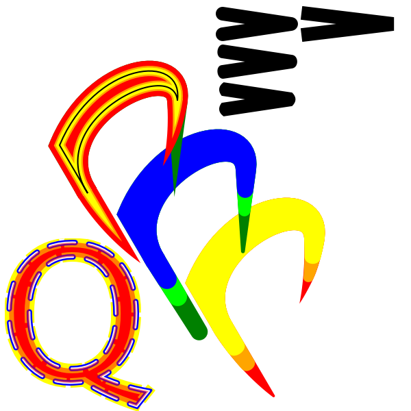
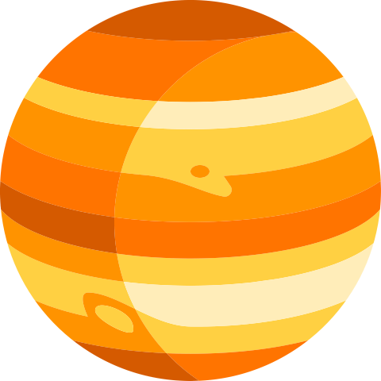
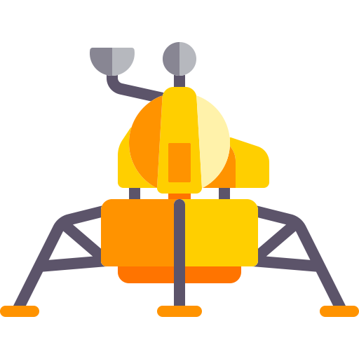
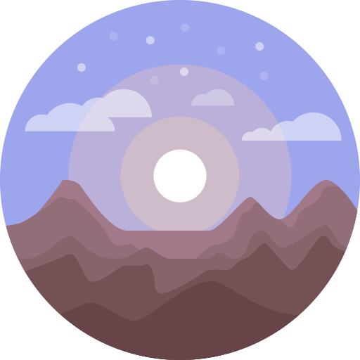

# oksvg

> **go-gfx/oksvg is a maintained fork of [srwiley/oksvg](https://github.com/srwiley/oksvg)**,
> imported at upstream commit `be6e8873101c` (2022-10-11, upstream's HEAD at the time of the
> fork), under upstream's BSD-3-Clause licence (`LICENSE`, unchanged). Its changes are listed
> in the pull requests of this repository; the first one imports upstream unmodified except
> for the module path.

### What this fork adds

* **`clipPath`** ([SVG 1.1 §14.3](https://www.w3.org/TR/SVG11/masking.html#ClippingPaths), CSS Masking §6):
  the `clip-path` property on any element or group, `<clipPath>` with shapes, `<path>` and
  `<use>`, `clipPathUnits` (`userSpaceOnUse`, `objectBoundingBox`), a `transform` on the
  clipPath, `clip-rule` (`nonzero`, `evenodd`), `clip-path` on a clipPath (intersection) and on
  its children (clipped before the union), ancestors' clips intersecting, anti-aliased edges.
  A clip is rasterised into an 8-bit coverage mask and multiplies the alpha of what is drawn
  under it; a drawing without `clipPath` runs the code it always did. A reference that does not
  resolve, or is circular, is ignored; an empty clip clips everything; a mask larger than
  16 million pixels is not applied. A `<clipPath>` is never drawn, wherever it stands.
  Checked against Chrome on synthetic cases (all within 0.5% of pixels) and on Twemoji.
* **Arc commands with several parameter sets** (`a10 10 0 0 1 5 5 8 8 0 0 1 3 3`): each set is
  its own arc. Upstream reused the first set's parameters, which drew visibly wrong shapes
  (Twemoji's 🪇, 🏔 ...).
* **`fill-rule`** (`nonzero`, `evenodd`; SVG 1.1 §11.3, inherited, also as a CSS property in a
  `style` attribute). rasterx's scanner has one rule, so an `evenodd` fill takes its coverage
  from the clip rasteriser and is composited with the same `draw.DrawMask`; `nonzero` fills take
  the code path they always did. Gradients, opacity and clips work with it.
* **Arc flags without separators** (`A9.564 9.564 0 0110 4.844`: flags 0 and 1, then x = 10; SVG
  1.1 §8.3.9). Upstream read `0110` as one number, which dropped the rest of the path: GitHub's
  octocat drew as a crescent.
* **`SvgIcon.Shapes()`: the drawing as vector shapes**, for writers that draw paths themselves
  (PDF, DrawingML, ODF): each fill with its curves and rule, each stroke as the closed outline
  rasterx's own stroker makes (width, caps, joins, miter limit, dashes), solid colours and
  linear/radial gradients resolved to user space, clip paths as one path each, opacities in the
  alpha, all in viewBox units. It reports `exact == false` when part of the drawing has no exact
  vector form here (a gradient whose stops change opacity, `reflect`/`repeat`, a skewed linear or
  a focal or non-uniform radial gradient, a clipPath mixing rules or clipping its own shapes), for
  the caller to rasterise instead. Tested by rendering the shapes back and comparing them with
  `Draw` (≤ 1% of pixels).
* **Strokes scale with the transform** (SVG 1.1 §7.6: lengths on a transformed element are in its
  new user space). Upstream stroked at the untransformed width, so a 4-unit line under `scale(2)`
  was 4 pixels wide, not 8; dashes and their offset now scale too.
* **`scale(s)` with one number is `scale(s, s)`** (SVG 1.1 §7.6). Upstream read it as `scale(s, 0)`,
  which flattened the element onto a line and made its strokes vanish.

oksvg is a rasterizer for a partial implementation of the SVG2.0 specification in golang.

Although many SVG elements will not be read by oksvg, it is good enough to faithfully produce thousands, but certainly not all, SVG icons available both for free and commercially. A list of valid and invalid elements is in the doc folder.

oksvg uses the [rasterx](https://github.com/srwiley/rasterx) rasterizer package which implements full SVG2.0 path functions, including the newer 'arc' join-mode.

### Extra non-standard features.

In addition to 'arc' as a valid join mode value, oksvg also allows 'arc-clip' which is the arc analog of miter-clip and some extra capping and gap values. It can also specify different capping functions for line starts and ends.

#### Rasterizations of SVG to PNG from creative commons 3.0 sources.

Example renderings of unedited open source SVG files by oksvg and rasterx are shown below.

Thanks to [Freepik](http://www.freepik.com) from [Flaticon](https://www.flaticon.com/)
Licensed by [Creative Commons 3.0](http://creativecommons.org/licenses/by/3.0/) for the example icons shown below, and also used as test icons in the testdata folder.

### Non-standard library dependencies
oksvg requires the following imports which are not included in the go standard library:

* golang.org/x/net/html/charset
* golang.org/x/image/colornames
* golang.org/x/image/math/fixed

These can be included in your gopath by the following 'get' commands:

* "go get golang.org/x/image/math/fixed"
* "go get golang.org/x/image/colornames"
* "go get golang.org/x/net/html/charset"

oksvg also requires the user to get or clone into the workspace the rasterx package located here:

* github.com/srwiley/rasterx

